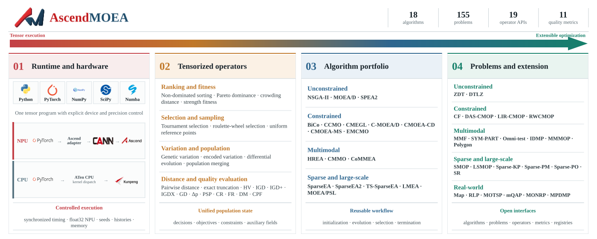

<p align="center">
  
</p>

<h1 align="center">AscendMOEA</h1>

<p align="center">
  High-performance tensorized multi-objective evolutionary optimization for Huawei Ascend NPUs and CPUs
</p>

<p align="center">
  <a href="./docs/README_zh.md">中文</a> ·
  <a href="https://ascendmoea.readthedocs.io/en/latest/">Documentation</a>
</p>

AscendMOEA is a high-performance, tensorized platform for multi-objective evolutionary
optimization on Huawei Ascend NPUs and general-purpose CPUs. Its unified PyTorch tensor
execution model connects populations, algorithms, problems, evolutionary operators,
quality indicators, synchronized timing, and runtime monitoring through one consistent
interface. Researchers can move from CPU prototyping to Ascend NPU acceleration and
reproducible large-scale experiments without rebuilding their workflow.

Version `1.0.0` includes 18 algorithms, 155 benchmark or real-world problems, 19 public
population operators, and 11 quality indicators. Problem evaluation and core population
operations are batch-oriented, while tensors retain their device and precision metadata.

## Platform architecture

<p align="center">
  
</p>

AscendMOEA unifies runtime and hardware control, tensorized operators, algorithm portfolios,
and extensible problem suites in a reproducible execution pipeline. The same platform supports
convenient CPU development and scalable high-performance experiments on Huawei Ascend NPUs.

## Installation

AscendMOEA requires Python 3.9 or later. For a CPU environment, run from the project root:

```bash
python -m pip install .
```

Install experiment and plotting dependencies when needed:

```bash
python -m pip install ".[experiment]"
python -m pip install ".[plot]"
```

An Ascend environment requires mutually compatible drivers, CANN, PyTorch, and `torch_npu`.
After loading the CANN environment, use `--no-deps` to avoid replacing the adapted PyTorch
installation:

```bash
source /usr/local/Ascend/nnrt/set_env.sh
source /usr/local/Ascend/ascend-toolkit/set_env.sh
python -m pip install . --no-deps
```

## Quick start

```python
from ascendmoea import optimize
from ascendmoea.algorithms import NSGAII
from ascendmoea.metrics import hv, igd
from ascendmoea.problems import DTLZ2

problem = DTLZ2(n=100, m=3, max_fe=10_000)
result = optimize(
    NSGAII(save=20),
    problem,
    device="cpu",
    cpu_threads=8,
    seed=42,
)

print("evaluations", result.evaluations)
print("seconds", result.elapsed_seconds)
print("HV", hv(result.population, problem.optimum))
print("IGD", igd(result.population, problem.optimum))
```

In a configured Ascend environment, change `device="cpu"` to `device="npu:0"`. The standard
workflow synchronizes the device queue before and after timing, so `elapsed_seconds` covers
all computation submitted by the run.

## Public modules

- `ascendmoea`: `Population`, `Problem`, `Algorithm`, `Workflow`, monitors, and device interfaces.
- `ascendmoea.algorithms`: algorithm classes, the registry, and name-based factories.
- `ascendmoea.problems`: problem classes, the registry, and name-based factories.
- `ascendmoea.operators`: sorting, selection, distance, crossover, mutation, sampling, and population composition.
- `ascendmoea.metrics`: HV, IGD, IGD+, GD, IGDX, PSP, and related indicators.
- `ascendmoea.experiment`: reproducible repeated experiments, summaries, and non-parametric statistics.
- `ascendmoea.plotting`: objective-space, decision-space, and metric-curve visualization.

Start with the [API index](docs/en/15_api_index.md), then read
[Installation and Ascend environment](docs/en/02_installation.md),
[Your first optimization task](docs/en/03_first_optimization.md), and
[Runnable examples](docs/en/14_examples.md). The complete sequence is available in the
[English reading guide](docs/en/00_reading_guide.md) and the
[online English documentation](https://ascendmoea.readthedocs.io/en/latest/).

## Installation verification

```bash
python - <<'PY'
import ascendmoea
from ascendmoea.algorithms import NSGAII
from ascendmoea.problems import DTLZ2

problem = DTLZ2(n=20, m=2, max_fe=100)
result = ascendmoea.optimize(
    NSGAII(save=1),
    problem,
    device="cpu",
    cpu_threads=1,
    seed=42,
)
print("version", ascendmoea.__version__)
print("device", result.device)
print("population", len(result.population))
print("evaluations", result.evaluations)
PY
```

The output should show the version, `cpu`, a non-empty population, and an evaluation count
that is not below the budget. In an Ascend environment, change `device="cpu"` to
`device="npu:0"` after loading CANN as described in
[Installation and Ascend environment](docs/en/02_installation.md).

## License

This project is released under the non-commercial research and educational terms in
`LICENSE`. Required attribution and third-party conditions for algorithms, benchmarks,
and data are documented in `NOTICE.md`; read both files before use or redistribution.
