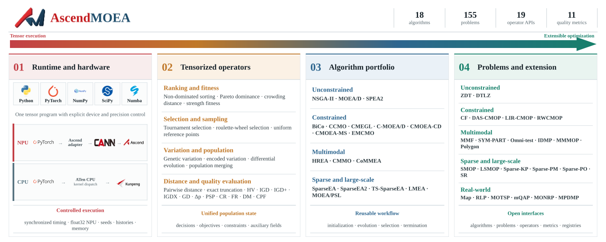

<p align="center">
  
</p>

<h1 align="center">AscendMOEA</h1>

<p align="center">
  面向华为昇腾 NPU 与通用 CPU 的高性能张量化多目标进化优化平台
</p>

<p align="center">
  <a href="../README.md">English</a> ·
  <a href="https://ascendmoea.readthedocs.io/zh-cn/latest/">网页文档</a>
</p>

AscendMOEA 以统一的 PyTorch 张量计算体系贯穿种群、算法、问题、进化算子、质量指标、
同步计时与运行监控，让研究人员能够使用同一套接口完成 CPU 原型验证、昇腾 NPU 加速和
可复现实验。平台覆盖无约束、约束、多模态及稀疏大规模多目标优化，并为算法研究、工程
扩展和大规模实验提供完整而开放的基础设施。

版本 `1.0.0` 提供 18 个算法、155 个基准或实际问题、19 个公开种群算子和 11 个质量
指标。问题评价与主要种群操作面向完整批次，张量始终保留设备和精度信息。

## 平台框架

<p align="center">
  
</p>

AscendMOEA 将运行环境、张量化算子、算法组合和问题扩展统一在一条可复现执行链路中，
既支持在通用 CPU 上便捷开发，也支持在华为昇腾 NPU 上直接扩展高性能优化实验。

## 安装

要求 Python 3.9 及以上版本。CPU 环境在项目根目录执行：

```bash
python -m pip install .
```

实验和绘图依赖按需安装：

```bash
python -m pip install ".[experiment]"
python -m pip install ".[plot]"
```

昇腾环境需要预先安装互相兼容的驱动、CANN、PyTorch 和 `torch_npu`。加载 CANN 环境
后，使用 `--no-deps` 可避免替换已适配的 PyTorch：

```bash
source /usr/local/Ascend/nnrt/set_env.sh
source /usr/local/Ascend/ascend-toolkit/set_env.sh
python -m pip install . --no-deps
```

## 快速开始

```python
from ascendmoea import optimize
from ascendmoea.algorithms import NSGAII
from ascendmoea.metrics import hv, igd
from ascendmoea.problems import DTLZ2

problem = DTLZ2(n=100, m=3, max_fe=10_000)
result = optimize(
    NSGAII(save=20),
    problem,
    device="cpu",
    cpu_threads=8,
    seed=42,
)

print("evaluations", result.evaluations)
print("seconds", result.elapsed_seconds)
print("HV", hv(result.population, problem.optimum))
print("IGD", igd(result.population, problem.optimum))
```

在已配置的昇腾环境中，将 `device="cpu"` 改为 `device="npu:0"`。标准工作流会在计时
前后同步设备队列，`elapsed_seconds` 因而覆盖本次运行提交的完整计算。

## 公开模块

- `ascendmoea`：`Population`、`Problem`、`Algorithm`、`Workflow`、监控器和设备接口。
- `ascendmoea.algorithms`：算法类、算法注册表和名称工厂。
- `ascendmoea.problems`：问题类、问题注册表和名称工厂。
- `ascendmoea.operators`：排序、选择、距离、交叉、变异、采样和种群组合。
- `ascendmoea.metrics`：HV、IGD、IGD+、GD、IGDX、PSP 等指标。
- `ascendmoea.experiment`：可复现重复实验、汇总和非参数统计。
- `ascendmoea.plotting`：目标空间、决策空间和指标曲线。

完整接口从 [API 索引](15_API速查.md) 进入。首次使用建议依次阅读
[安装与昇腾环境](02_安装与昇腾环境.md)、
[第一个优化任务](03_第一个优化任务.md) 和
[可运行案例集](14_可运行案例集.md)。全部入口见
[中文文档阅读路线](00_阅读路线.md)，也可直接访问
[Read the Docs 中文文档](https://ascendmoea.readthedocs.io/zh-cn/latest/)。

## 安装验证

```bash
python - <<'PY'
import ascendmoea
from ascendmoea.algorithms import NSGAII
from ascendmoea.problems import DTLZ2

problem = DTLZ2(n=20, m=2, max_fe=100)
result = ascendmoea.optimize(
    NSGAII(save=1),
    problem,
    device="cpu",
    cpu_threads=1,
    seed=42,
)
print("version", ascendmoea.__version__)
print("device", result.device)
print("population", len(result.population))
print("evaluations", result.evaluations)
PY
```

输出应显示版本号、`cpu`、非空种群以及不小于预算的评价次数。昇腾环境可把
`device="cpu"` 改为 `device="npu:0"`，并先按
[安装与昇腾环境](02_安装与昇腾环境.md) 加载 CANN 环境。

## 许可

本项目按 `LICENSE` 中的非商业研究与教育条款发布。算法、基准和数据的必要归属及第三方
条件见 `NOTICE.md`；使用或重新分发前应同时阅读两份文件。
